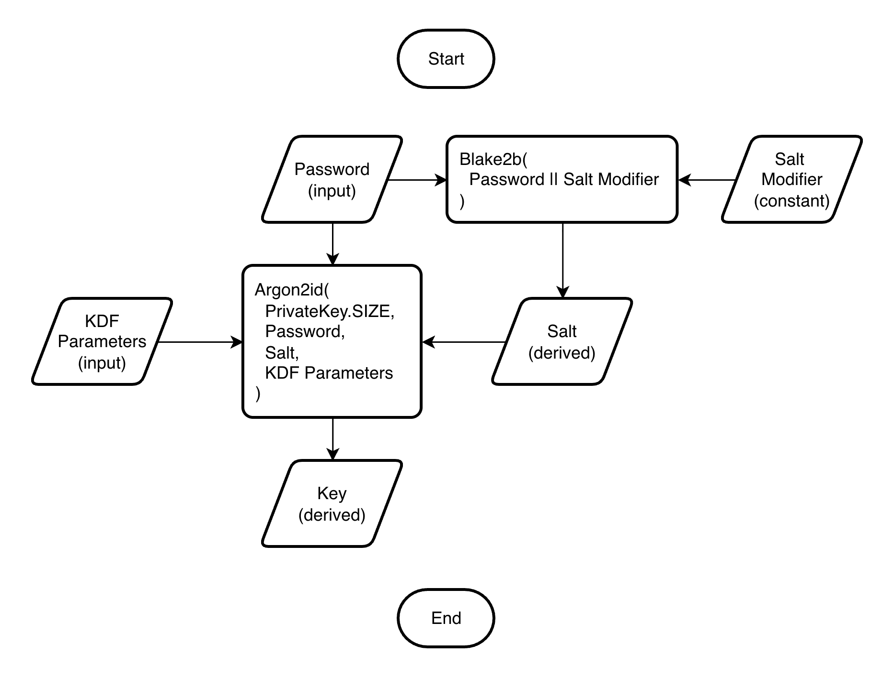
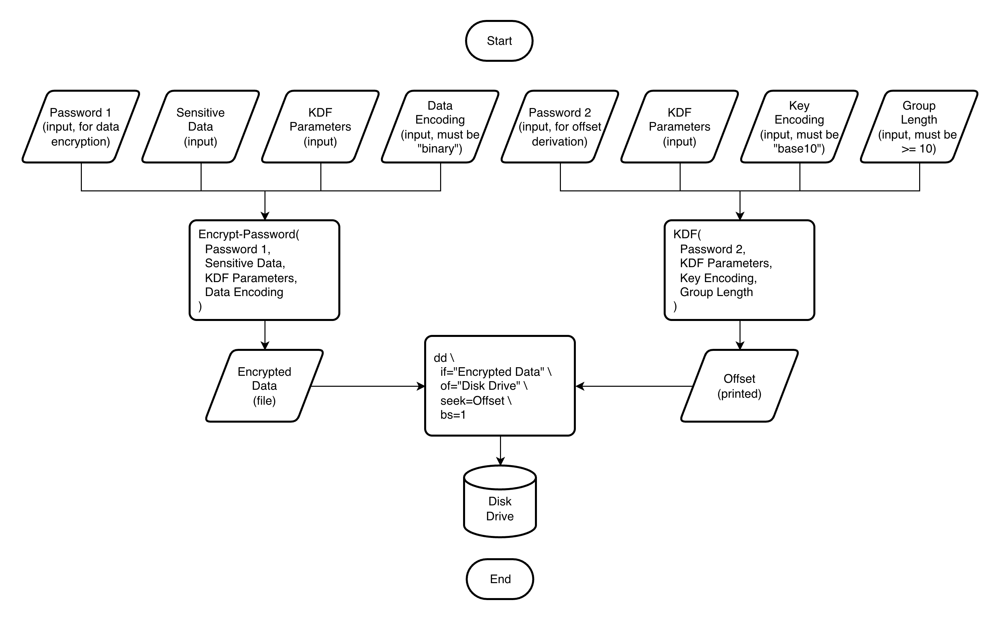

# rtty-soda

A PyNaCl frontend with custom encodings, compression, and key derivation.


#### Features

- Public key encryption (Curve25519-XSalsa20-Poly1305)
- Secret key encryption (XSalsa20-Poly1305)
- Key derivation (Argon2id-Blake2b)
- Text compression:
  - brotli (Brotli, best ratio, default)
  - zstd (Zstandard, fast, good ratio)
  - zlib (Deflate, used by gzip)
  - bz2 (Bzip2, used in tar.bz2)
  - lzma (LZMA, good ratio on large data)
  - raw (No compression, improves security)
- Custom encodings:
  - base10 (Decimal)
  - base26 (Latin)
  - base31 (Cyrillic)
  - base32 (RFC 4648)
  - base36 (Latin with digits)
  - base64 (RFC 4648)
  - base94 (ASCII printable)
  - binary (Raw bytes)


## Installation
#### Package manager

1. [Install uv](https://docs.astral.sh/uv/getting-started/installation/)
2. Install rtty-soda:
   ```
   % uv tool install "rtty-soda[cli]"
   ```
3. Remove rtty-soda:
   ```
   % uv tool uninstall rtty-soda
   ```

#### Docker

```
% docker run -it --rm -h rtty-soda -v .:/app/host nett/rtty-soda:0.7.5
% docker run -it --rm -h rtty-soda -v .:/app/host nett/rtty-soda:0.7.5-tools
```


## Getting help

All commands have `[-h | --help]` option.

```
% soda
Usage: soda [OPTIONS] COMMAND [ARGS]...

Options:
  --version   Show the version and exit.
  -h, --help  Show this message and exit.

Commands:
  compression            List supported compression libs.
  decrypt-password (dp)  Decrypt message (password).
  decrypt-public (d)     Decrypt message (public).
  decrypt-secret (ds)    Decrypt message (secret).
  encode                 Encode file.
  encodings              List supported encodings.
  encrypt-password (ep)  Encrypt message (password).
  encrypt-public (e)     Encrypt message (public).
  encrypt-secret (es)    Encrypt message (secret).
  genkey                 Generate private/secret key.
  google-auth (ga)       Google Authenticator TOTP.
  kdf                    Key derivation function.
  kdf-profiles           List supported KDF profiles.
  pubkey                 Get public key.
```

Some commands have aliases, so `% soda encrypt-password ...` and `% soda ep ...`
are equivalent.


## Public key encryption
#### Key generation

```
% soda genkey | tee alice | soda pubkey - | tee alice_pub
C3V5OctfZpdZ/Jyb23D6g8dYQY247xDuVM+1B6soRgA=

% soda genkey | tee bob | soda pubkey - | tee bob_pub
1uRs9G4Fgariscqz/RttRX3WyUHrp/O/dYICMAWCq3s=

% soda genkey -h
Usage: soda genkey [OPTIONS]

  Generate private/secret key.

Options:
  -s, --key-passphrase TEXT  Private/secret key passphrase.
  -e, --encoding ENCODING    See `soda encodings`.  [default: base64]
  -o, --output-file FILE     Write output to file.
  -g, --group-len INTEGER    [default: 0]
  --line-len INTEGER         [default: 80]
  --padding INTEGER          [default: 0]
  -v, --verbose              Show verbose output.
  -h, --help                 Show this message and exit.
```

#### Encryption

Alice sends the message to Bob:

```
% cat message
A telegraph key is a specialized electrical switch used by a trained operator to
transmit text messages in Morse code in a telegraphy system.
The first telegraph key was invented by Alfred Vail, an associate of Samuel Morse.
(c) Wikipedia

% soda encrypt-public alice bob_pub message | tee encrypted | cut -c 1-80
WUe26CkIBBi6XV29CfB+JnFQaVGdzH+ep16RoUneemLAaQPW9bUXanI28x2dFt7fFSjHP0Gl7UFeCHBh

% soda encrypt-public -h
Usage: soda encrypt-public [OPTIONS] PRIVATE_KEY_FILE PUBLIC_KEY_FILE
                           MESSAGE_FILE

  Encrypt message (public).

Options:
  -t, --text                     Treat message as text (binary if not
                                 specified).
  -s, --key-passphrase TEXT      Private/secret key passphrase.
  --key-encoding ENCODING        See `soda encodings`.  [default: base64]
  -e, --data-encoding ENCODING   See `soda encodings`.  [default: base64]
  -c, --compression COMPRESSION  See `soda compression`.  [default: brotli]
  -o, --output-file FILE         Write output to file.
  -g, --group-len INTEGER        [default: 0]
  --line-len INTEGER             [default: 80]
  --padding INTEGER              [default: 0]
  --short-nonce                  Use a 12-byte nonce instead of 24.
  -v, --verbose                  Show verbose output.
  -h, --help                     Show this message and exit.
```

#### Decryption

```
% soda decrypt-public bob alice_pub encrypted
A telegraph key is a specialized electrical switch used by a trained operator to
transmit text messages in Morse code in a telegraphy system.
The first telegraph key was invented by Alfred Vail, an associate of Samuel Morse.
(c) Wikipedia
```


## Secret key encryption

Alice and Bob share a key for symmetric encryption:

```
% soda genkey > shared
% soda encrypt-secret shared message -o encrypted
% soda decrypt-secret shared encrypted -o message
```

Another day, they share a password:

```
% echo qwerty | soda encrypt-password - message -p interactive -o encrypted
% echo qwerty | soda decrypt-password - encrypted -p interactive -o message
```


## Key derivation

The KDF function derives the key from the password using Argon2id, a memory-hard
algorithm that makes brute-force attacks expensive by requiring large amounts of
memory.

It accepts different profiles: 
- interactive (64 MiB, 2 passes)
- moderate (256 MiB, 3 passes)
- sensitive (1 GiB, 4 passes)

The top profile uses 1 GiB - half the memory of the RFC 9106 recommendation for
practical use. The profiles are defined by libsodium.

The KDF function is deterministic, so identical passwords produce identical keys.
No metadata is stored or asked of the user to keep the interface simple.
The trade-off is that password strength is critical.

```
% echo qwerty | soda kdf - -p interactive
HqbvUXflAG+no3YS9njezZ3leyr8IwERAyeNoG2l41U=

% soda kdf -h
Usage: soda kdf [OPTIONS] PASSWORD_FILE

  Key derivation function.

Options:
  -s, --key-passphrase TEXT  Private/secret key passphrase.
  -e, --encoding ENCODING    See `soda encodings`.  [default: base64]
  -p, --profile PROFILE      See `soda kdf-profiles`.  [default: sensitive]
  -o, --output-file FILE     Write output to file.
  -g, --group-len INTEGER    [default: 0]
  --line-len INTEGER         [default: 80]
  --padding INTEGER          [default: 0]
  -v, --verbose              Show verbose output.
  -h, --help                 Show this message and exit.
```




## Text compression

That works as follows:
1. The plaintext is prepared:
   - In binary mode (default), the message is read as bytes
   - In text mode (`-t, --text`), the message is read as a string, stripped, and encoded with SCSU, reducing the size of Unicode messages by 15–50%
2. The plaintext is compressed with the compression lib
3. The 16-byte MAC and 24-byte nonce are added
4. The result is encoded with Base64, which adds ~33% overhead

```
% soda es shared message -t -v -c brotli > /dev/null
Plaintext: 238
Ciphertext: 216
Overhead: 0.908
Groups: 1
% soda es shared message -t -v -c zstd > /dev/null
Plaintext: 238
Ciphertext: 276
Overhead: 1.160
Groups: 1
% soda es shared message -t -v -c zlib > /dev/null
Plaintext: 238
Ciphertext: 280
Overhead: 1.176
Groups: 1
% soda es shared message -t -v -c bz2 > /dev/null
Plaintext: 238
Ciphertext: 336
Overhead: 1.412
Groups: 1
% soda es shared message -t -v -c lzma > /dev/null
Plaintext: 238
Ciphertext: 320
Overhead: 1.345
Groups: 1
% soda es shared message -t -v -c raw > /dev/null
Plaintext: 238
Ciphertext: 372
Overhead: 1.563
Groups: 1
```


## Encoding

The rtty-soda supports various encodings:

```
% soda encrypt-public alice bob_pub message --data-encoding base36 --group-len 5 --text
7AHZ9 V9BFE U211B EW9JZ SA0JX WZW7C MP2FW YUGEN H3E1E 58DRN 8AULR 08IBY 5BJF3
SXK2J BGCKQ UAXIE PTJCC HXSZA KLW3J HUPJK NGCYB UQ4BU KJM38 GIAZP ZZVKA DAN4C
N74OD 0JOAM KSXSG ZDD6Y 55BJS 49BNS 0IJBO D8AZN T9VFG ALUL3 Y2XB5 3YOMO UTNFF
7ARJ9 6QGSQ I90TC 7DNDB 1SE95 ZY09U UUQ9K 1GMMM P90P5 AKD6Z B0Z
```


## Environment variables

Common options can be set in the environment variables:

```
% cat ~/.soda/example.env
SODA_TEXT=0
SODA_KEY_PASSPHRASE="He in a few minutes ravished this fair creature, or at least would have ravished her, if she had not, by a timely compliance, prevented him."
SODA_KEY_ENCODING=binary
SODA_DATA_ENCODING=binary
SODA_COMPRESSION=brotli
SODA_KDF_PROFILE=sensitive
SODA_GROUP_LEN=0
SODA_LINE_LEN=0
SODA_PADDING=0
SODA_SHORT_NONCE=0
SODA_VERBOSE=0
```


## Private/secret key passphrase

The key can be protected with an additional passphrase, similar to SSH keys.
When `--key-passphrase <passphrase>` is used, the key is automatically
encrypted or decrypted using the same parameters as the following command:

```
% soda encrypt-password <passphrase> <key> --kdf-profile sensitive --data-encoding binary --compression raw
```


## Alternative usage

- Password source
  ```
  % echo "A line from a book or a poem" | soda kdf - -e base94 -p interactive
  x\R9"~8Ujh^_uh:Ty<!t(ZNzK=5w^ukew~#-x!n
  ```

- WireGuard keyer
  ```
  % echo "A line from a book or a poem" | soda kdf - -p interactive -o privkey
  % cat privkey
  uIoBJdgaz8ZP3/n/9KzdUNvFi7DxbUQdQ9t8ujwGnMk=
  % soda pubkey privkey
  F2B674kXVcTznnRPWCVasx1miCT+yUtXQ3P5Ecee4zI=
  % cat privkey | wg pubkey
  F2B674kXVcTznnRPWCVasx1miCT+yUtXQ3P5Ecee4zI=
  ```

- Secure storage
  ```
  % echo "A remarkable example of misplaced confidence" > sensitive_data
  % echo "Blessed with opinions, cursed with thought" > data_password
  % soda ep data_password sensitive_data -e binary -p interactive -o encrypted_data
  % echo "Too serious to be wise" > offset_password
  % soda kdf offset_password -e base10 -p interactive -g 10 | head -1
  6174465709 4962164854 2541023297 3274271197 5950333784 2118297875 9632383288
  % sudo dd if=./encrypted_data of=/dev/sdb1 bs=1 seek=6174465709
  75+0 records in
  75+0 records out
  75 bytes transferred in 0.000769 secs (97529 bytes/sec)
  ```

  

- Google Authenticator keyer
  ```
  % soda genkey -e base32 | tee totp_key
  OXGBCBYZ755TNN6DNAOAXHCHSBAR52GWRWRIALWBHQTMO3QUMPZQ====
  % soda google-auth totp_key
  537 004 (expires in 7s)
  ```


## Tutorial for the Underground Moscow Museum

```
% docker run -it --rm -h rtty-soda -v .:/app/host nett/rtty-soda:0.7.5-tools

% source ~/.soda/museum.env
% soda genkey | tee 173-закрытый | soda pubkey - | tee 173-публичный
ЖЯКВЬ ЮКЭЧШ ГПРВО ЮЩГЫК ВЫНБФ ААСЭД ХАГЭЕ ПЩЛНЭ ТИХСТ ЫССДЫ МЩ
% soda genkey | tee 305-закрытый | soda pubkey - | tee 305-публичный
ЗЬХВГ КЯЫИЧ ПФЗЖН ФМСВЭ ДНКЧЮ УЬЕЕЦ УКДПЬ МЕХЦТ БЮЧЗР МРНБА ЫЫ

% cat телеграмма
Телетайп — стартстопный приёмно-передающий телеграфный аппарат с клавиатурой
как у пищущей машинки, применявшийся также в качестве терминала устройств
вычислительной техники.
Наиболее совершенные телетайпы являются полностью электронными устройствами
и используют дисплей вместо принтера.
(c) Wikipedia

% soda e 173-закрытый 305-публичный телеграмма -v
КЭРЗЖ СЬТЭЧ ЗКЫМГ ЩККУЮ ХЭЩЖВ АШЖЗС БЧУСЫ ЩЙБДА ЙПРПШ КВЙФШ РЕЯПЕ
ШНАТЫ МИЮРК ЖЦЫШЛ КОРЩВ ХЭФШФ ПНВЬК ЯКДВД КШГЙБ АЕЮРЮ ПЖРДШ ЕТХЬА
ЧЙБЗЫ ЧЯЛЧЦ БУЧПУ ОГЛЫЭ ФМОЦК ПАГФЧ ЩЮКЮЩ ФЛФЮГ ЕЕЯШТ ЬКЫЯЫ ГЫБВЗ
ТХРМГ ЯУХЩП ЮЗКМЭ ЧХЩЖЛ ДЖПХУ УЫЫПС РСЮЕУ ЫНЛФГ ЬНЯИУ АЕДМТ ПЧУЖЖ
УУШЖА ЮБЫЫУ ЬЩХВД РУНЧЦ НЭОЗВ ТЯАОЕ БУОШЩ ЕЩТКУ САЕЬЦ ЯДХМЮ ОЖПИТ
УНУИН ЦООСЩ ИЮЩНЯ ЫРРФЦ СЯАДК УШЕИЩ АЮУЬЕ ЗЙЦКЬ ЕРЮЩИ ЧПАЖЫ БВЧЭХ
ШЗЦВЕ ЕИЫДС ШЙТЖИ ЙЩХЮУ ЩПУДЗ УЮВЮЩ УВГЯБ УЬХЕФ БРЧПЛ ЯДЮЮД ЯШЭХХ
НЯЭОЫ МЬЬЕУ ЖЯЧН
Plaintext: 302
Ciphertext: 399
Overhead: 1.321
Groups: 80
```


## Compatibility

During the initial development (versions prior to 1.0.0),
I can break backwards compatibility.


## Releases

This project follows a rolling release cycle.
Each version bump represents where I completed a full test cycle.
When testing passes successfully, I commit and release - so every release is a verified stable point.